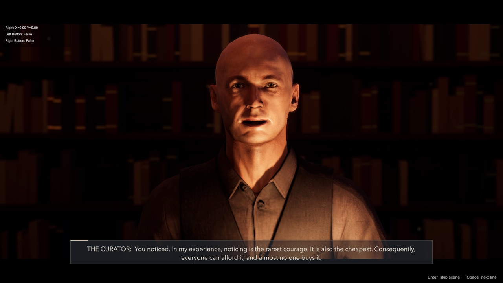
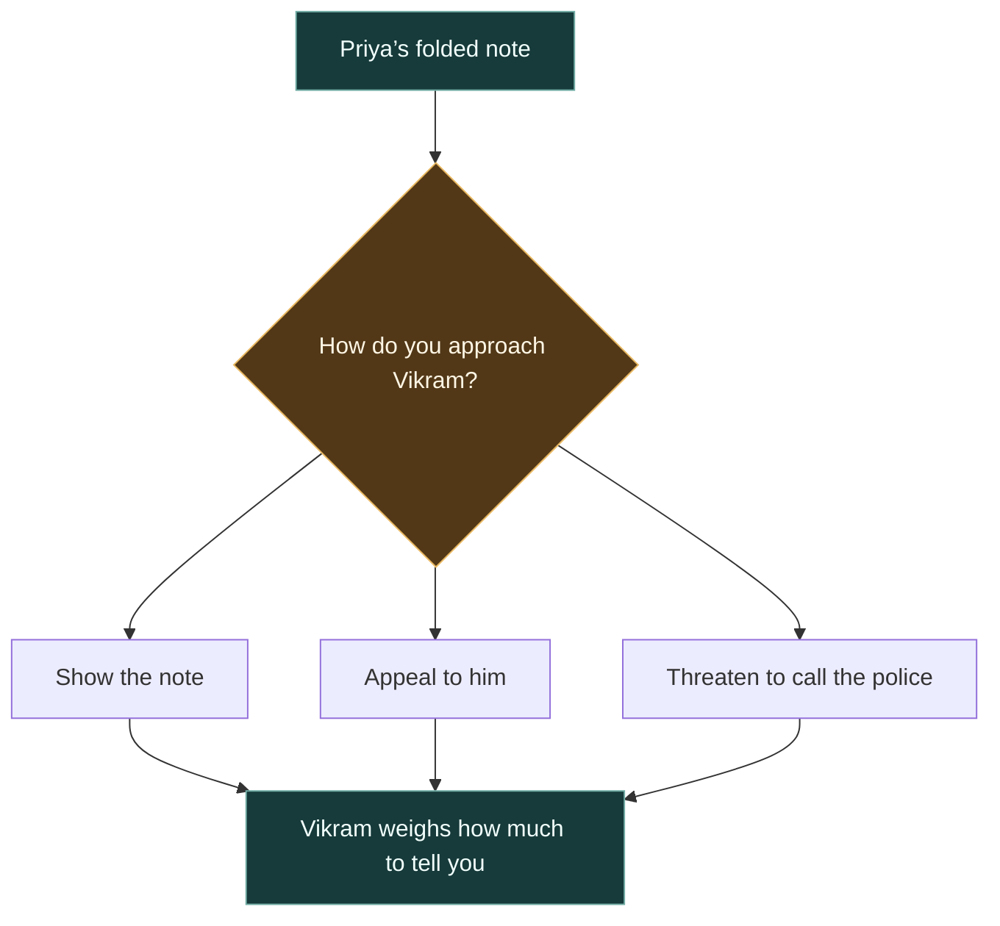
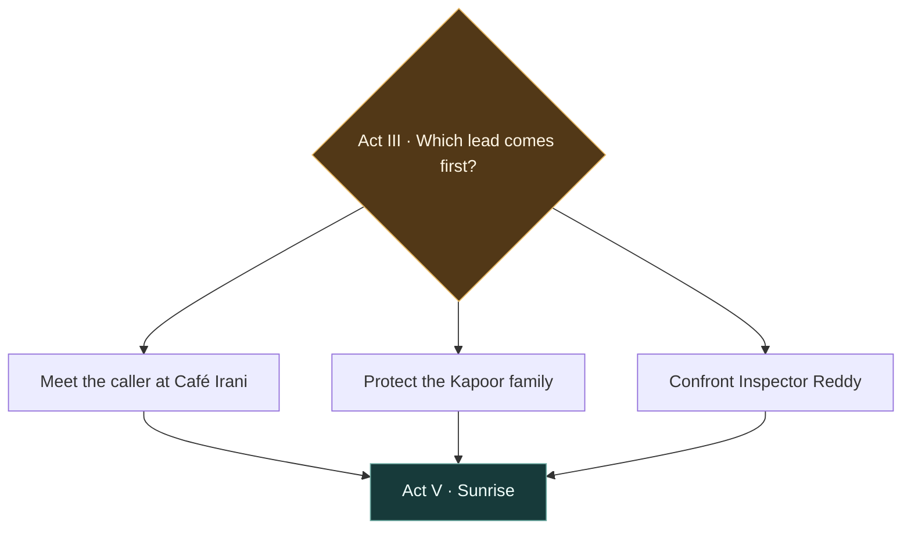

<div align="center">

# Shadows of Chandni

**A detective game by the Pinnacle team**

*One missing advocate. Five hundred families. A hearing at ten tomorrow morning.*

[The case](#the-case) · [Run the game](#run-the-game) · [Controls](#controls) · [Inside the project](#inside-the-project)

</div>



## The case

At six on Tuesday evening, private investigator **Arjun Mehra** steps into Priya Kapoor’s flat in Chandnipur’s Old Quarter. There are two chai cups in the kitchen and a half-packed suitcase by the bed. Priya is missing. Her mother wants to know where she went.

Priya is an advocate investigating a redevelopment project that could displace five hundred families in Basti Nagar. The municipal court hears the case on Wednesday morning. You have one night to retrace her steps, find people willing to speak, and work out what their stories can prove.

## Playing detective

- **Read the room.** Examine objects up close, use detective vision to pick out leads, and reopen your journal when a detail from the flat turns up somewhere else.
- **Earn a witness’s trust.** At Vikram’s chai stall, you can show him what you found, appeal to him, or bring up the police. How you ask changes what he is willing to tell you.
- **Follow the paper trail.** Priya’s notes, photographs, and the Old Chandnipur Library’s records connect across locations. A detail that seems personal can be the one that opens the archive.
- **Choose where to spend the night.** Three routes lead out of Act III. Your evidence and allies carry forward, and the finale has three discoverable endings. The Curator appears between chapters to reflect on your decisions.

### At Vikram’s chai stall



### The five acts

| Act | Chapter | Your lead |
| --- | --- | --- |
| I | **The Empty Room** | Search Priya’s flat and hear Kamala’s account of her daughter’s disappearance. |
| II | **The Streets Know** | Trace Priya’s movements through a night bazaar, from an auto driver to a wary chai seller. |
| III | **The File** | Follow the records through the old library, its basement archive, and the Kali Temple. |
| IV | **The Web** | Meet a contact at Café Irani, protect the Kapoor family, or confront Inspector Reddy. |
| V | **Sunrise** | Face the final decision and see what becomes of the people who trusted you. |

### The Act IV crossroads



## Run the game

1. Install **Unity Editor 6000.5.9f1** through Unity Hub. This is the version recorded in [ProjectVersion.txt](ProjectSettings/ProjectVersion.txt).
2. Download and extract the repository ZIP, or clone it with Git.

   ```sh
   git clone https://github.com/shivendra2008/Pinnacle.git
   ```

3. In Unity Hub, choose **Add project from disk** and select the folder containing `Assets`, `Packages`, and `ProjectSettings`.
4. Open the project and let Unity finish importing assets. In the Project window, open **Assets → Scenes → SampleScene**, then press **Play**. Click inside the Game view to give it keyboard and mouse focus.

<details>
<summary><strong>Build a standalone macOS app</strong></summary>

Install macOS build support for the same editor version. Close the project in the editor, then run this from the repository root using the standard Unity Hub install path.

```sh
"/Applications/Unity/Hub/Editor/6000.5.9f1/Unity.app/Contents/MacOS/Unity" \
  -batchmode -projectPath "$PWD" \
  -executeMethod BuildPlayer.MacOS -logFile "$PWD/build.log"
```

The default output is `Builds/macOS/Pinnacle.app`. The [build script](Assets/Editor/BuildPlayer.cs) includes the shader variants used by the environments at runtime.

</details>

## Controls

| Action | Keyboard and mouse |
| --- | --- |
| Walk / move faster | **W A S D** / hold **Shift** while moving |
| Look around | Move the **mouse** |
| Examine evidence or interact | **E** |
| Detective vision / journal | **Tab** / **J** |
| Preview a compass reply | Move the **mouse** or use the **arrow keys** |
| Commit the highlighted reply | **Click**, **E**, **Enter**, or **Space** |
| Choose a numbered reply directly | **1–4** |
| Skip a spoken line / conversation | **Space** / **Enter** during dialogue |
| Pause / change graphics quality | **Esc** / **F2** |

During a compass choice, the highlighted intention previews Arjun’s full reply. Most conversations give you time to read it. Watch the countdown when a decision is timed.

**Saving and replay.** Continue from the title menu to return to your campaign checkpoint. Chapter replay starts with the evidence you had when you first reached that act. You can explore another outcome while preserving your main investigation. [Save and replay details](Docs/SAVES.md)

## Inside the project

Built with **Unity 6**, **C#**, and the **Universal Render Pipeline**. The project starts from a single scene. C# scripts construct the locations, place clues and witnesses, and carry the investigation between acts.

| Location | Contents |
| --- | --- |
| [Assets/Scripts](Assets/Scripts) | Act logic, location builders, dialogue, character behaviour, decision compass, and saves |
| [Assets/Resources](Assets/Resources) | Character models, props, signs, materials, voices, and environmental audio |
| [Assets/Editor](Assets/Editor) | Standalone build tooling and the automated playtest harness |
| [Tools](Tools) | Content-generation utilities and optional Arduino joystick firmware |
| [Graphics notes](GRAPHICS.md) | Rendering and visual setup |
| [Playtest guide](Docs/PLAYTEST.md) | How to run the project checks and interpret their output |

<details>
<summary><strong>Developer reference · contains story spoilers</strong></summary>

The [story bible](Docs/STORY_BIBLE.md) tracks the night’s timeline, what each witness knows, and how evidence and choices feed into the endings. The [original project report](Docs/Shadows_of_Chandni_Project_Report.pdf) documents the earlier two-act milestone.

</details>

## Credits

Created by the [Pinnacle contributors](https://github.com/shivendra2008/Pinnacle/graphs/contributors). The in-game credits acknowledge character models from Microsoft Rocketbox and Quaternius, voices produced with macOS speech synthesis, and storm and Gallery recordings from Wikimedia Commons. See the [ending credits](Assets/Scripts/Act5Story.cs) for individual recording attributions and licenses. The linked source contains ending spoilers.
